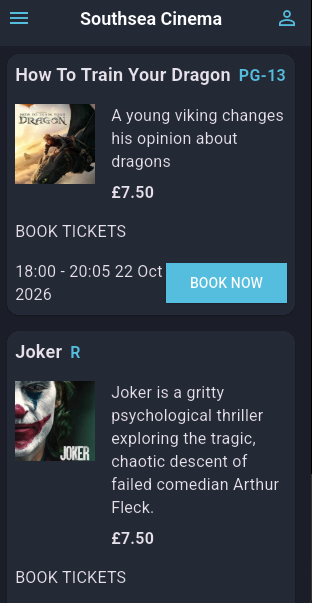
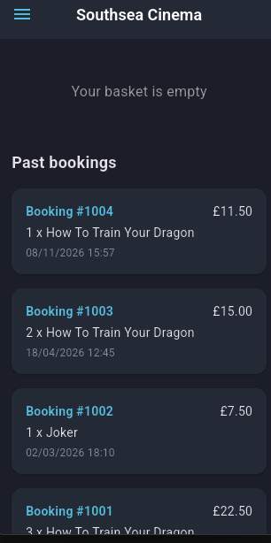
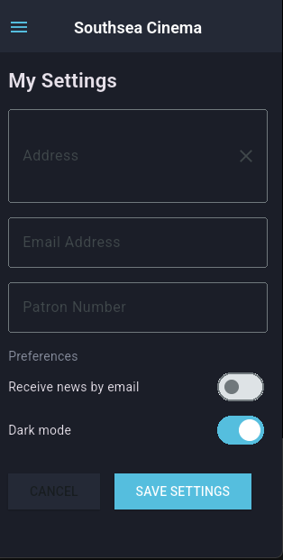
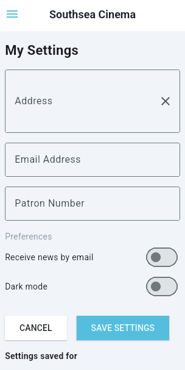

# Southsea Cinema

A Flutter app for browsing films at Southsea Cinema, choosing tickets and
keeping a record of your bookings. It is built for the University of
Portsmouth Flutter coursework and runs on an Android emulator.


## Features

- Browse the films, loaded from a JSON file in the app assets.
- Open a film to see its room, date and time, then choose 1 to 5 tickets and
  add them to your order.
- Review your order on the basket screen. Each line shows the number of
  tickets, the film, the date, the room and the price, and can be deleted.
- See a service charge of £4.00 and the total due. The service charge is not
  added when the basket is empty.
- Buy the tickets to save a booking. The basket is cleared only after the
  booking has been saved.
- See your past bookings, newest first. They are kept in a local SQLite
  database, so they are still there after you close and reopen the app.
- Save your address, email address, patron number and newsletter choice in
  Settings.
- Switch between dark mode and light mode in Settings. The choice is saved and
  used the next time the app starts.
- Move between Home, My Basket and My Settings with the menu drawer.

## Screenshots









## Supported platform

The app has been run and tested on the Android emulator. It has not been
tested on a browser or on a desktop.

## Getting started

### Prerequisites

You need:

- [Flutter](https://docs.flutter.dev/get-started/install)
- Android Studio with an Android emulator
- Git

On Windows, turn on Developer Mode in the Windows settings before the first
build. The plugins used by the app need it.

### Install dependencies

```bash
flutter pub get
```

### Run the app

Start the emulator, then run the app on it:

```bash
flutter emulators --launch flutter_emulator
flutter run -d emulator-5554
```

If your emulator has a different name, list the available ones with
`flutter emulators`.

## Running the tests

Run all the tests:

```bash
flutter test
```

Check the code style and look for problems:

```bash
dart format lib test
dart analyze
```

The database tests use an in-memory SQLite database, so they run without an
emulator. The widget tests use an in-memory version of shared preferences.

## How the app works

- **Films** come from `assets/data/movies.json`. The menu screen loads them
  when it opens and shows a loading spinner or an error message.
- **The basket** is held by `BasketRepository`, which has one shared instance
  for the whole app. It works out the subtotal, the service charge and the
  total.
- **Bookings** are saved by `CinemaDatabase` in a SQLite database file.
  The first time the database is created it is filled with three sample
  bookings.
- **Settings** are saved with `SharedPreferencesAsync`: the address, email,
  patron number, newsletter choice and dark mode choice.
- **The theme** is set in `main.dart`. The app reads the saved dark mode
  choice when it starts. Saving Settings changes the theme straight away.

## Project structure

```text
southsea_cinema/
├── assets/
│   └── data/movies.json            # The films
├── lib/
│   ├── constants.dart              # Colours, text style and app title
│   ├── main.dart                   # App, themes and routes
│   ├── database/
│   │   └── cinema_db.dart          # SQLite database for bookings
│   ├── models/
│   │   ├── basket_item.dart        # A film and a number of tickets
│   │   ├── booking.dart            # A saved booking
│   │   ├── movie.dart              # A film
│   │   └── user_settings.dart      # The saved settings
│   ├── repositories/
│   │   ├── basket_repository.dart  # The order and its totals
│   │   └── movie_repository.dart   # Loads and filters the films
│   ├── screens/
│   │   ├── basket_screen.dart      # Order, checkout and past bookings
│   │   ├── menu_screen.dart        # The film list
│   │   └── settings_screen.dart    # Settings form and dark mode
│   ├── views/
│   │   └── movie_listing.dart      # One film and its ticket choice
│   └── widgets/
│       ├── movie_card.dart         # A film in the list
│       ├── nav_drawer.dart         # The menu drawer
│       ├── primary_button.dart     # The blue button
│       └── settings_button.dart    # The person icon in the app bar
├── test/                           # Mirrors the lib folder
├── pubspec.yaml                    # Dependencies and assets
└── README.md                       # This file
```

## Packages

- `shared_preferences` saves the settings.
- `sqflite` and `path` store the bookings in SQLite.
- `sqflite_common_ffi` runs the database tests without an emulator.
